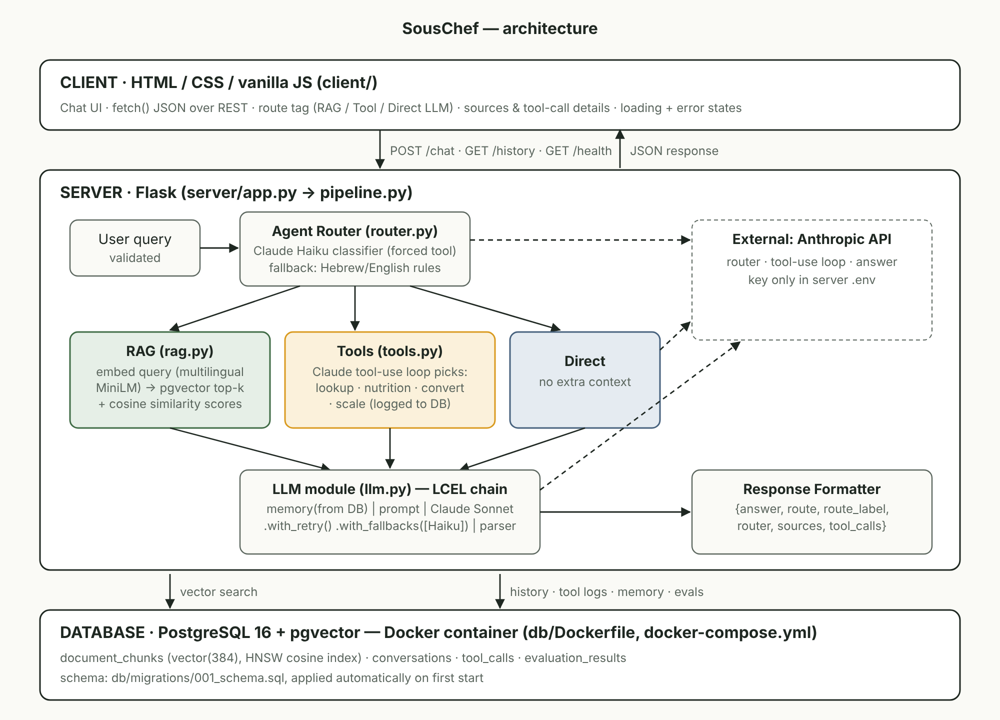

# SousChef — Agentic Recipe & Nutrition Assistant

**[English](#english) · [עברית](#hebrew)**



---

<a id="english"></a>
## English

### 1. Topic
**SousChef** is a recipe and nutrition assistant for home cooks (example domain #4 in the project specification).

- **Target user:** a home cook who wants to know how to make a dish, how to store it, what to substitute, how many calories it has, or how to scale it for guests — in English or Hebrew.
- **Knowledge base (RAG):** 10 recipes (shakshuka, hummus, falafel, challah, chicken schnitzel, red lentil soup, Israeli salad, banana bread, pasta al pomodoro, tahini cookies) and a kitchen safety & substitutions guide, in `data/recipes/`.
- **Tools:** nutrition maths, unit conversion and recipe scaling must be exact — an LLM alone gets multi-step arithmetic wrong — so they are done by Python tools.

### 2. Architecture
```
CLIENT (HTML/JS)  →  SERVER (Flask)  →  DATABASE (PostgreSQL + pgvector, Docker)

Inside the server, every /chat request:
USER QUERY → AGENT ROUTER → RAG / TOOLS → LLM → RESPONSE
```

| Layer | Where | What it does |
|---|---|---|
| Client | `client/` | Chat UI in plain HTML/CSS/vanilla JS. `fetch()` with JSON. Shows a coloured tag with the router's path (RAG / Tool: … / Direct LLM), the router's reason, sources with similarity scores, tool inputs/outputs, a "Thinking…" indicator and readable errors. No keys, no direct API/DB access. |
| Agent Router | `server/router.py` | **LLM classifier** (Claude Haiku) that is *forced* to call a `route_query` tool, so the decision is structured JSON: `route`, `reason`, `confidence`, an English `search_query` with pronouns resolved from the last turns, and `suggested_tools`. If the LLM call fails, or `ROUTER_MODE=rules`, a **Hebrew + English rule-based router** decides. Every decision carries a reason that is shown in the UI and saved in the DB. |
| RAG module | `server/rag.py`, `server/ingest.py` | Embeds the query with `paraphrase-multilingual-MiniLM-L12-v2` (local, via fastembed — Hebrew questions match English recipes), searches pgvector by cosine distance (HNSW index), returns top-k chunks with similarity scores and drops those under a threshold. |
| Tools module | `server/tools.py` | 4 tools in the **Anthropic tool-use schema**: `lookup_recipe_ingredients`, `calculate_nutrition`, `convert_units`, `scale_recipe`. Claude picks tools and arguments in a tool-use loop (first turn forced with `tool_choice: any`, since the router already decided a tool is needed); Python executes them; every call is logged to `tool_calls`. |
| LLM module | `server/llm.py` | **LCEL chain**: `RunnablePassthrough.assign(history=load_memory) \| ChatPromptTemplate \| ChatAnthropic(Sonnet).with_retry(...).with_fallbacks([ChatAnthropic(Haiku)]) \| StrOutputParser`. Memory = last `MEMORY_TURNS` exchanges loaded from PostgreSQL, so it survives restarts. |
| Response formatter | `server/formatter.py` | Single JSON contract for every reply (below). |
| Database | `db/`, `docker-compose.yml` | PostgreSQL 16 + pgvector in Docker. Tables: `conversations`, `tool_calls`, `document_chunks`, `evaluation_results`. Schema in `db/migrations/001_schema.sql`, applied automatically on first start. |

#### Vector storage choice
**PostgreSQL + pgvector**, in the same container as the relational data. One service to run, one backup, and SQL joins between chunks and logs if needed. Embedding dimension 384, HNSW index with `vector_cosine_ops`.

#### Chunking strategy
1. `MarkdownHeaderTextSplitter` splits every file on `#`/`##`, so a chunk never mixes *Ingredients* with *Storage* — each recipe section is one unit of meaning.
2. `RecursiveCharacterTextSplitter` (700 chars, 100 overlap) splits any section that is still too long.
3. Every chunk gets a header `Recipe: <title> | Section: <section>`, so a chunk like "keeps 4 days in the fridge" still says which recipe it belongs to.

#### API contract
`POST /chat` — body `{"query": "...", "session_id": "optional, 8-64 chars"}`
```json
{
  "answer": "…",
  "route": "rag | tool | direct",
  "route_label": "RAG | Tool: Nutrition Calculator | Direct LLM | RAG → Direct LLM (no matching docs)",
  "router": {"method": "llm", "reason": "…", "confidence": 0.93, "search_query": "…", "suggested_tools": []},
  "sources": [{"ref": 1, "source": "hummus.md", "title": "Classic Hummus", "section": "Storage", "similarity": 0.71, "snippet": "…"}],
  "tool_calls": [{"name": "convert_units", "input": {…}, "ok": true, "output": {…}}],
  "warnings": [],
  "session_id": "…",
  "latency_ms": 1840
}
```
Errors: `{"error": {"code": "bad_request | llm_unavailable | db_unavailable | internal_error", "message": "…"}, "route": "…"}` with HTTP 400 / 502 / 503 / 500.

`GET /history?session_id=…&limit=50[&include_tools=true]` — past turns (with route, reason and sources) and optionally the tool-call log.
`GET /health` — server, database and knowledge-base status (HTTP 503 if the DB is down).

#### Error handling
| Situation | Behaviour |
|---|---|
| Malformed JSON, missing/empty/too-long `query`, bad `session_id` | 400 with a clear message |
| Empty knowledge base | RAG falls back to a general answer, labelled "RAG → Direct LLM (no matching docs)", with a warning |
| No chunk above the similarity threshold | Same fallback; the warning reports the best score |
| Tool fails (bad input, unknown recipe, exception) | Logged with `success=false`; the error goes back to Claude, which explains it; the request still succeeds |
| Router LLM fails | Rule-based router takes over (`method: "rules (llm fallback)"`) |
| Answer LLM fails | 3 retries with exponential back-off, then fallback model, then a clean 502 |
| DB down | `/health` → 503, `/history` → 503; `/chat` never crashes |

### 3. Setup and run

**Requirements:** Docker Desktop (or Docker Engine + Compose v2), an Anthropic API key. Python is only needed for running without Docker.

```bash
git clone <your-repo-url> souschef
cd souschef
cp .env.example .env          # then edit .env: set ANTHROPIC_API_KEY and POSTGRES_PASSWORD
docker compose up --build     # one command: database + server
```
Open **http://localhost:5000**.

On first start the server downloads the embedding model (~220 MB, cached in a Docker volume) and indexes the recipes automatically; `/health` shows the chunk count when it is done (about a minute).

Useful commands:
```bash
docker compose up -d db                                  # database only
docker compose exec server python ingest.py              # re-index after editing data/recipes
docker compose exec server python evaluate.py            # router accuracy + retrieval hit-rate
docker compose exec db psql -U souschef -d souschef      # inspect tables
docker compose down        # stop   (add -v to also delete the data volume)
```

**Run the server without Docker** (DB still in Docker):
```bash
docker compose up -d db
cd server
python -m venv .venv && source .venv/bin/activate        # Windows: .venv\Scripts\activate
pip install -r requirements.txt
python app.py                                            # http://localhost:5000
```

**Tests** (DB must be running; no API key or model download needed — LLM calls are faked):
```bash
cd server
EMBEDDING_BACKEND=hash ROUTER_MODE=rules python -m pytest -q
```

### 4. Configuration (`.env`)
| Variable | Default | Meaning |
|---|---|---|
| `ANTHROPIC_API_KEY` | — | Required for answers |
| `LLM_MODEL` / `LLM_FALLBACK_MODEL` | `claude-sonnet-5-5` / `claude-haiku-5-5` | Answer model and its fallback |
| `ROUTER_MODEL`, `ROUTER_MODE` | `claude-haiku-5-5`, `llm` | `rules` = no LLM call for routing |
| `POSTGRES_*` | see `.env.example` | DB credentials (shared by compose and server) |
| `EMBEDDING_MODEL` | multilingual MiniLM | Changing it requires a matching `vector(N)` size |
| `RAG_TOP_K`, `RAG_MIN_SIMILARITY` | 4, 0.35 | Retrieval breadth and relevance threshold |
| `MEMORY_TURNS` | 6 | Exchanges kept as conversational memory |

`.env` is in `.gitignore`; only `.env.example` is committed.

### 5. Project structure
```
souschef/
├── docker-compose.yml        # one-command startup
├── .env.example  .gitignore
├── client/                   # index.html, style.css, app.js
├── server/
│   ├── app.py                # Flask endpoints
│   ├── pipeline.py           # Router → RAG/Tools → LLM → Formatter
│   ├── router.py  rag.py  ingest.py  tools.py  recipes.py  llm.py  formatter.py
│   ├── db.py  config.py  evaluate.py
│   ├── tests/test_app.py
│   ├── requirements.txt  Dockerfile
├── db/
│   ├── Dockerfile            # pgvector/pgvector:pg16
│   └── migrations/001_schema.sql
├── data/recipes/*.md  data/nutrition_table.json
└── docs/                     # architecture diagram, topic proposal, reflection, demo script
```

### 6. Demo queries
| Path | Query |
|---|---|
| RAG | `How do I make shakshuka?` · `איך שומרים מרק עדשים במקפיא?` · `Can I bake schnitzel instead of frying it?` |
| Tool | `How many calories per serving are in the hummus?` · `Convert 2 cups of flour to grams` · `Scale the challah for 24 people` |
| Direct | `Hi, what can you do?` · `What is umami?` |
| Memory | `How do I make falafel?` then `How long does it keep in the freezer?` |

See `docs/DEMO_SCRIPT.md` for the full demo, `docs/TOPIC_PROPOSAL.md` and `docs/REFLECTION.md` for the other deliverables.

---

<a id="hebrew"></a>
<div dir="rtl">

## עברית

### 1. נושא הפרויקט
**SousChef** הוא עוזר מתכונים ותזונה לבשלנים ביתיים (דוגמה מס' 4 במסמך ההנחיות).

- **משתמש היעד:** מבשל/ת ביתי/ת שרוצה לדעת איך מכינים מנה, איך לאחסן אותה, במה להחליף מרכיב, כמה קלוריות יש בה או איך להגדיל אותה לאורחים — בעברית או באנגלית.
- **מאגר הידע (RAG):** ‏10 מתכונים (שקשוקה, חומוס, פלאפל, חלה, שניצל, מרק עדשים כתומות, סלט ישראלי, עוגת בננה, פסטה פומודורו, עוגיות טחינה) ומדריך בטיחות מזון ותחליפים, בתיקייה `data/recipes/`.
- **כלים:** חישובי תזונה, המרת יחידות והגדלת מתכונים חייבים להיות מדויקים — מודל שפה לבדו טועה בחשבון רב־שלבי — ולכן הם מבוצעים בכלי Python.

### 2. ארכיטקטורה
</div>

```
CLIENT (HTML/JS)  →  SERVER (Flask)  →  DATABASE (PostgreSQL + pgvector, Docker)
USER QUERY → AGENT ROUTER → RAG / TOOLS → LLM → RESPONSE
```

<div dir="rtl">

| שכבה | מיקום | תפקיד |
|---|---|---|
| לקוח | `client/` | ממשק צ'אט ב־HTML/CSS/JavaScript נקי, קריאות `fetch()` עם JSON. מציג תגית צבעונית עם המסלול שהנתב בחר (RAG / Tool / Direct LLM), את נימוק הנתב, מקורות עם ציון דמיון, קלט ופלט של הכלים, חיווי "Thinking…" והודעות שגיאה ברורות. ללא מפתחות וללא גישה ישירה ל־API או למסד. |
| נתב הסוכן (Agent Router) | `server/router.py` | **מסווג מבוסס LLM** ‏(Claude Haiku) שחייב לקרוא לכלי `route_query`, כך שההחלטה חוזרת כ־JSON מובנה: מסלול, נימוק, רמת ביטחון, שאילתת חיפוש באנגלית (עם פתרון כינויים מההקשר) וכלים מומלצים. אם הקריאה נכשלת, או כש־`ROUTER_MODE=rules`, **נתב מבוסס חוקים בעברית ובאנגלית** מחליט. כל החלטה כוללת נימוק שמוצג בממשק ונשמר במסד. |
| מודול RAG | `server/rag.py`, `server/ingest.py` | מטמיע את השאלה במודל רב־לשוני מקומי (שאלה בעברית מוצאת מתכון באנגלית), מחפש ב־pgvector לפי מרחק קוסינוס (אינדקס HNSW), ומחזיר את k הקטעים הקרובים עם ציון דמיון, תוך סינון קטעים מתחת לסף. |
| מודול כלים | `server/tools.py` | ארבעה כלים בסכמת **tool-use של Anthropic**: `lookup_recipe_ingredients`, ‏`calculate_nutrition`, ‏`convert_units`, ‏`scale_recipe`. ‏Claude בוחר כלי וארגומנטים, Python מריץ, וכל קריאה נרשמת בטבלה `tool_calls`. |
| מודול LLM | `server/llm.py` | **שרשרת LCEL**: טעינת זיכרון ממסד הנתונים ← תבנית פרומפט ← Claude Sonnet עם `with_retry` ו־`with_fallbacks` למודל Haiku ← מפענח פלט. הזיכרון נשמר ב־PostgreSQL ולכן שורד הפעלה מחדש של השרת. |
| מעצב תגובה | `server/formatter.py` | חוזה JSON אחיד לכל תשובה: תשובה, מסלול, מקורות, קריאות כלים, אזהרות. |
| מסד נתונים | `db/`, `docker-compose.yml` | ‏PostgreSQL 16 עם pgvector בקונטיינר Docker. טבלאות: היסטוריית שיחה, לוג כלים, קטעי מסמכים עם וקטורים ותוצאות הערכה. הסכמה ב־`db/migrations/001_schema.sql` ומוחלת אוטומטית בהפעלה הראשונה. |

#### בחירת אחסון הווקטורים
**PostgreSQL + pgvector** באותו קונטיינר עם הנתונים הרלציוניים: שירות אחד להרצה ולגיבוי. מימד 384, אינדקס HNSW עם `vector_cosine_ops`.

#### אסטרטגיית החלוקה (Chunking)
1. פיצול לפי כותרות Markdown — קטע אף פעם לא מערבב "מרכיבים" עם "אחסון".
2. פיצול נוסף לפי תווים (700 תווים, חפיפה של 100) לסעיפים ארוכים.
3. לכל קטע נוספת כותרת `Recipe: <שם> | Section: <סעיף>`, כדי שקטע כמו "נשמר 4 ימים במקרר" יגיד לאיזה מתכון הוא שייך.

#### טיפול בשגיאות
בקשה פגומה מחזירה 400 עם הודעה ברורה; מאגר ידע ריק או חוסר התאמה מספקת גורמים לתשובה כללית עם תווית "RAG → Direct LLM" ואזהרה; כלי שנכשל נרשם בלוג והשגיאה מוסברת למשתמש; כישלון של הנתב מעביר לנתב החוקים; כישלון של מודל התשובה עובר שלושה ניסיונות חוזרים, מודל גיבוי ואז 502 מסודר; מסד נתונים שאינו זמין מחזיר 503. השרת לא קורס באף אחד מהמקרים.

### 3. התקנה והרצה

**דרישות:** ‏Docker Desktop (או Docker Engine עם Compose v2) ומפתח API של Anthropic. ‏Python נדרש רק להרצה ללא Docker.

</div>

```bash
git clone <your-repo-url> souschef
cd souschef
cp .env.example .env          # לערוך את .env: ANTHROPIC_API_KEY ו-POSTGRES_PASSWORD
docker compose up --build     # פקודה אחת: מסד נתונים + שרת
```

<div dir="rtl">

לפתוח בדפדפן: **http://localhost:5000**

בהפעלה הראשונה השרת מוריד את מודל ההטמעה (כ־220MB, נשמר ב־volume) ומאנדקס את המתכונים אוטומטית; כשהתהליך מסתיים (כדקה), `/health` מציג את מספר הקטעים.

פקודות שימושיות:

</div>

```bash
docker compose exec server python ingest.py              # אינדוקס מחדש אחרי עריכת מתכונים
docker compose exec server python evaluate.py            # דיוק הנתב ואחוז הצלחת האחזור
docker compose exec db psql -U souschef -d souschef      # עיון בטבלאות
docker compose down                                      # עצירה (‎-v מוחק גם את הנתונים)
```

<div dir="rtl">

**הרצת השרת ללא Docker** (המסד עדיין ב־Docker):

</div>

```bash
docker compose up -d db
cd server
python -m venv .venv && source .venv/bin/activate        # Windows: .venv\Scripts\activate
pip install -r requirements.txt
python app.py
```

<div dir="rtl">

**בדיקות** (המסד צריך לרוץ; לא נדרש מפתח API — קריאות המודל מוחלפות בדמה):

</div>

```bash
cd server
EMBEDDING_BACKEND=hash ROUTER_MODE=rules python -m pytest -q
```

<div dir="rtl">

### 4. הגדרות וסודות
כל המפתחות והסיסמאות נטענים ממשתני סביבה בקובץ `.env`, שמופיע ב־`.gitignore` ולעולם לא נשמר ב־Git. בריפו נמצא רק `.env.example`. טבלת המשתנים המלאה מופיעה בחלק האנגלי.

### 5. שאילתות להדגמה
- **RAG:** "איך מכינים שקשוקה?", "איך שומרים מרק עדשים במקפיא?"
- **כלי:** "כמה קלוריות יש במנה של חומוס?", "Convert 2 cups of flour to grams", "Scale the challah for 24 people"
- **תשובה ישירה:** "שלום, מה אתה יודע לעשות?", "What is umami?"
- **זיכרון שיחה:** "איך מכינים פלאפל?" ואחר כך "כמה זמן אפשר לשמור את זה במקפיא?"

תסריט ההדגמה המלא נמצא ב־`docs/DEMO_SCRIPT.md`; הצעת הנושא ב־`docs/TOPIC_PROPOSAL.md`; הרפלקציה ב־`docs/REFLECTION.md`.

</div>
